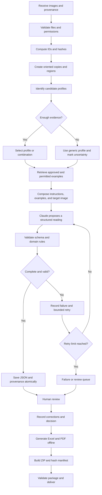
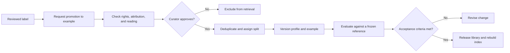
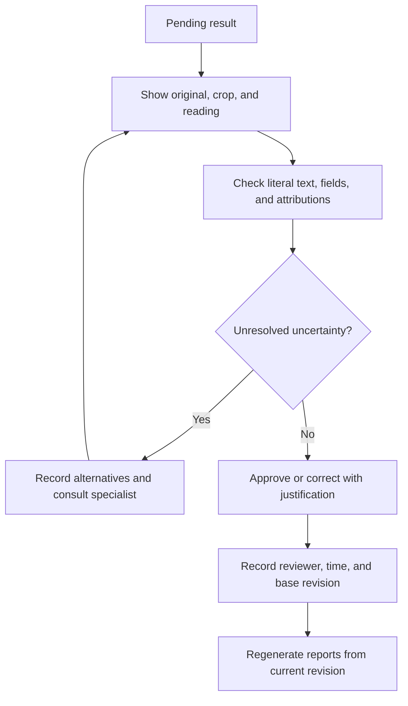
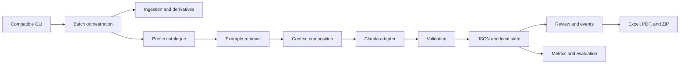

# Historical botanical label library — implementation roadmap

Date: 2026-10-25. Documentation language: English.
Status: iterative implementation plan; proposed features are not necessarily implemented. **Section 25 updates the historical assumptions below and records the current implementation.**

## 1. Purpose and proposal

Evolve the PO/LISU bryophyte transcription script into a reusable library of documented historical profiles and reviewed examples, integrated with Claude → Pydantic → JSON → Excel/PDF → ZIP.

Start with candidate profiles for Gonçalo Sampaio, Frère Sennen, Carlos Zimmermann, and Alphonse Luisier, keeping a generic fallback and support for other people, institutions, series, and label layouts. These profiles begin as drafts. Languages, handwriting, dates, abbreviations, and historical characteristics require documentary evidence and curation. Record name variants as sourced aliases without assuming identity.

The proposed library is a versioned catalogue that retrieves examples to contextualize the model. The MVP does not require training, a vector database, or a web server. Evaluate any claimed improvements against the current script on independent data; the project's usefulness does not depend on outperforming another tool.

A profile may help reading. It never authorizes filling missing text, silently correcting names, or attributing authorship without evidence.

## 2. Recovered context and historical limitations

The initial plan relied on a textual attachment to a previous architecture discussion, containing a Markdown rendering of a script rather than a confirmed executable Python file. Locating the real source was therefore an initial requirement. Do not reconstruct executable code by indiscriminately deleting asterisks or backslashes. Section 25 records the subsequent source inspection and extraction.

Observed baseline behavior:

- `Etiqueta(BaseModel)` contains rotation, herbarium, series, scientific name, taxonomic author, determiner, geography, ecology, altitude, UTM, dates, collector, number, handwriting, literal text, and uncertainties.
- `upright()` applies EXIF orientation and clockwise reading rotation. `encoded()` limits the longest edge to 1568 pixels and sends JPEG.
- Baseline `transcrever()` uses Claude structured output, six concurrent tasks, timeout/retries, and one JSON per filename stem; it originally skipped existing files without content/configuration verification.
- `relatorio()` produces the existing “Transcrição literal” and “Campos” sheets, thumbnails, oriented copies, and PDF without an API call.
- `lote()` processes pending readings, requires a reading for every photograph, and checks a temporary ZIP before replacement.
- Inputs are JPG, JPEG, PNG, HEIC, and HEIF in the immediate directory.
- The delivery ZIP contains Excel, image copies, and optional PDF; JSON is not currently included.
- The bryophyte prompt is PO/LISU-specific, includes collection-specific date conventions, and adds an editorial source prefix to the literal transcription.

The original model identifier and fixed prices were not verified as current. Check official Anthropic documentation and the installed SDK, especially structured output, image limits, usage, and prices. Never substitute a guessed model name.

No curated historical corpus was available in the original planning context. Counts and targets below are proposals, not measured results. Unrelated server-retrieval architecture from earlier discussions is outside this project.

## 3. Scope and decisions

### Proposed MVP

1. Preserve existing commands and legacy JSON reading.
2. Extract a reusable core with a compatible entry point.
3. Register profiles, examples, provenance, rights, and versions.
4. Start with manual profile selection; evaluate automatic candidates and an unknown option later.
5. Retrieve approved examples and compose bounded Claude context.
6. Validate readings and record uncertainties and human revisions.
7. Produce compatible outputs and an optional auditable package.
8. Measure quality, cost, and active review time.

### Outside the MVP

Model training, a complete web interface, mandatory vector infrastructure, universal automatic segmentation, and automatic taxonomic updates. Taxonomic/geographic reconciliation is an independent, sourced, reviewed stage.

### Fundamental decisions

- Keep originals immutable and derivatives separate.
- Validated JSON is the source of truth; Excel/PDF are representations.
- Separate literal text, extracted fields, and normalized interpretations.
- Distinguish institution, series, collector, determiner, taxonomic author, and writer.
- “Instituto de Botânica Dr. Gonçalo Sampaio” in a letterhead does not prove that Sampaio collected or wrote the label.
- Allow several profiles per label and several labels per image.
- Uncalibrated similarity is not an authorship probability.
- Reviewing a transcription does not automatically approve it as a reusable example.

## 4. Proposed end-to-end workflow

### 4.1 Processing and delivery



Input failures need per-file diagnostics. Partial delivery requires an explicit option and prominent pending items in the manifest. Default behavior retains the current requirement for a complete batch.

### 4.2 Curation and improvement



### 4.3 Human review



## 5. Proposed architecture

The CLI coordinates small services. Only the Claude adapter accesses the API; import, review, and export work offline. Start with JSON and, if needed, local SQLite for queues/indexes. Scientific data/events must be exportable and sufficient to reconstruct state.



Proposed contracts:

- `ingest(path) -> Asset`: validate file, hash, and provenance.
- `identify(asset, catalog) -> CandidateSet`: candidates, evidence, and unknown.
- `retrieve(query, candidates, policy) -> list[ExampleRef]`: filtering and ranking.
- `compose(target, profiles, examples, budget) -> PromptBundle`: context and hashes.
- `transcribe(bundle, config) -> ModelProposal`: proposal without human approval.
- `validate(proposal) -> ValidationReport`: structural errors separate from scientific warnings.
- `save_revision(record, expected_revision) -> RevisionRef`: atomic writes and concurrency control.
- `export(snapshot, destination) -> ArtifactManifest`: artifacts tied to identified revisions.

Inject fake providers in tests. Each concurrent task returns its own result; aggregate centrally rather than mutating unprotected shared counters.

## 6. Proposed directory evolution

Adapt to the real repository instead of moving everything before a baseline. The current package is `src/herbarium_labels/`; the submodules below are architectural proposals, not existing APIs.

```text
herbarium-labels/
  PLAN.md
  pyproject.toml
  requirements.lock
  .env.example
  src/herbarium_labels/
    cli.py                        # proposed orchestration split
    config.py
    models/                       # Pydantic, schemas, migration
    ingestion/                    # files, hashes, EXIF, derivatives
    profiles/                     # catalogue and validation
    retrieval/                    # index, filtering, ranking
    prompts/                      # templates and composition
    providers/claude.py
    pipeline/                     # tasks, state, resume
    review/                       # events and corrections
    exports/                      # Excel, PDF, ZIP, manifest
    evaluation/                   # metrics and comparison
  library/
    catalog.json
    profiles/                     # generic and four historical drafts
    examples/                     # metadata and image references
    schemas/                      # schemas generated from Pydantic
    sources/                      # curation references
    CHANGELOG.md
  datasets/
    manifests/                    # splits and hashes
    gold/                         # frozen human reference
  data/                           # ignored by Git
    originals/
    derivatives/
    review_events/
    local.sqlite
  runs/<run_id>/
    manifest.json
    config_resolved.json          # no secrets
    json/
    errors/
    metrics.json
    exports/
  tests/
    unit/
    integration/
    fixtures/
    evaluation/
  docs/
    curation.md
    schema.md
    review.md
    operations.md
    decisions/
```

Keep code and small metadata in Git. Store images/corpora with hashes and appropriate access controls; consider Git LFS where suitable. Do not publish collections without permission.

## 7. Proposed profile schema

Generate JSON Schema from Pydantic and validate on load. Use stable ASCII IDs and accented display names. Current and proposed interfaces use English identifiers; older Portuguese data remains readable through the dedicated compatibility layer.

```json
{
  "schema_version": "1.0.0",
  "profile_id": "goncalo-sampaio",
  "profile_version": "0.1.0",
  "status": "draft",
  "display_name": "Gonçalo Sampaio",
  "profile_kind": "person",
  "aliases": [],
  "entity_roles": [],
  "institution_ids": [],
  "collection_ids": [],
  "languages": [],
  "layout_variants": [],
  "visual_clues": [],
  "abbreviations": [],
  "date_rules": [],
  "transcription_guidance": [],
  "negative_clues": [],
  "source_refs": [],
  "approved_example_ids": [],
  "curation": {"reviewer_id": null, "reviewed_at": null},
  "notes": "Characteristics and attributions await curation."
}
```

Composite-field contracts:

- `profile_kind`: person, institution, series, label template, or generic.
- `aliases`: spelling, source, and type; a name correction does not change the ID.
- `entity_roles`: collector, determiner, writer, or series editor, with evidence for each assignment.
- `visual_clues`: characteristic, likely region, example IDs, source, and known limits.
- `abbreviations`: literal, proposed expansion, context, source, and ambiguity; expansion never replaces literal text.
- `date_rules`: pattern, evidence, scope, and abstention conditions; do not infer the century from the person.
- `layout_variants`: ID, anchors, and optional regions; an expected field is not necessarily present.
- `source_refs`: collection/bibliographic reference, location, access, and rights.
- `status`: draft, under review, approved, or retired. Only approved profiles enter automatic selection.

Create equivalent drafts for all four names without invented characteristics. Institution + series + person combinations are allowed. Record conflicting guidance; visible evidence takes priority.

## 8. Proposed example schema

Each example needs:

- `example_id`, `schema_version`, `example_version`, and curation status.
- `asset_id`, SHA-256, storage reference, dimensions, and verified MIME type.
- `label_id`, optional crop, and transformation. Coordinates refer to the original after EXIF orientation and before reading rotation.
- Associated profiles and their roles, evidence, sources, and curator.
- Human literal transcription, validated fields, uncertainties, and an approved reference revision.
- Languages, handwriting, layout variant, and difficulty only when curated.
- Institution/specimen identifier, provenance, and acquisition reference.
- Separate rights for local use, API submission, redistribution, and restrictions. Missing permission excludes the corresponding operation.
- A development/validation/test `split`, plus `specimen_group_id` to group photographs of one specimen and duplicates.
- Timezone-aware ISO 8601 timestamps and a hash of approved content.

Unreviewed model output is not ground truth. Multimodal examples must pair identified images and reviewed transcriptions; text alone does not demonstrate handwriting.

## 9. Proposed transcription schema

### 9.1 Canonical envelope

Create IDs/provenance outside the model. Claude proposes only the reading and evidence allowed by the contract.

```json
{
  "schema_version": "2.0.0",
  "record_id": "record-demo-001",
  "run_id": "run-demo",
  "asset": {
    "asset_id": "image-demo-001",
    "original_name": "photo.jpg",
    "relative_path": "originals/photo.jpg",
    "sha256": "<computed-hash>"
  },
  "labels": [{
    "label_id": "label-001",
    "region": null,
    "rotation_clockwise": 0,
    "profile_assignments": [],
    "literal": {"text": "", "lines": []},
    "fields": {},
    "interpretations": [],
    "uncertainties": []
  }],
  "provenance": {
    "library_version": "0.1.0",
    "profile_versions": [],
    "example_refs": [],
    "prompt_version": "1.0.0",
    "prompt_sha256": "<context-hash>",
    "model_id": "<configured-model>",
    "sdk_version": "<installed-version>"
  },
  "processing": {"status": "pending", "attempts": [], "usage": null},
  "review": {"status": "pending", "current_revision": 0, "event_refs": []}
}
```

Illustration only: placeholders do not pass production validation. Final hashes require 64 hexadecimal characters; `fields` will have an explicit model rather than an open dictionary.

### 9.2 Types and rules

- Clockwise rotation after EXIF: `Literal[0, 90, 180, 270]`; distinguish photograph and crop rotation.
- Current English domain fields are documented in `bryophytes.BryophyteReading`; the legacy-to-English mapping is in docs/MIGRATION.md. The proposed v2 field-state envelope is still future work.
- Each field has `raw: str | null`, `state`, and `evidence_line_ids`. States distinguish present, absent, illegible, partial, and not assessed. Preserve visible portions of partial readings.
- `literal.lines`: ID, order, text, printed/handwritten/mixed layer, and optional region. Preserve line breaks and label association.
- `profile_assignments`: ID/version, role, manual/automatic method, evidence, candidates, and optional similarity. Uncertain identity may remain unassigned.
- `interpretations`: source field, normalized value, method, source, justification, rule version, and review. Never overwrite literal text.
- `uncertainties`: field/line, type, visually plausible alternatives, reason, and resolution.
- Processing distinguishes pending, running, completed, failed, and cancelled, with attempts and sanitized errors.
- Review distinguishes pending, under review, approved, corrected, and rejected. A model cannot issue human approval.

Pydantic must forbid extra fields, bound sizes, validate references, and check real dates. Structural validation does not establish scientific fidelity.

### 9.3 Literal text, dates, and multiple labels

Preserve spelling and `data_como_escrita`. Set `data_iso` only for an unambiguous full date. A year/month alone belongs in an interpretation with explicit precision. Keep `03/04/05` ambiguous without additional evidence. PO/LISU conventions do not automatically apply to historical profiles.

Current `[Porto]`/`[LISU]` prefixes are editorial. Keep them separate from canonical literal text; a documented legacy exporter may reinsert them. Expansions, inferences, and editorial notes must not appear to be characters observed in the image.

Create separate records for labels in one photograph, preserving spatial order. Never transfer a collector/date automatically between labels. Manual regions are acceptable in the MVP; uncertain segmentation requires review.

### 9.4 Legacy migration proposal

1. Treat unversioned JSON as a v1 candidate and validate its known format.
2. Preserve the original file/hash before converting `leitura`.
3. Create a provisional label with segmentation marked unreviewed.
4. Map an empty v1 string to `not_assessed`: absence and illegibility cannot be distinguished retrospectively.
5. Separate editorial prefixes while preserving source text in the audit record.
6. Project to v1 when needed: nulls become empty strings and uncertainties a text list. Never silently flatten several labels; prefer one row per label in new outputs.
7. Document projection losses and compare old/new report fixtures.

## 10. Proposed identification and example retrieval

### Identification

Start with `--profile ID`; a batch profile is a suggestion with per-label exceptions. Later, printed anchors, institution, series, observed signatures, and layout may suggest up to three candidates plus unknown. Optional OCR/identification calls count toward cost and provenance.

Calibrate thresholds and candidate margins on validation data only. Without sufficient negatives, keep automatic selection advisory. A name in a letterhead alone establishes neither identity nor role.

### Retrieval

1. Filter approval, available versions, rights, API permission, and authorized split.
2. Exclude the target, exact/visual duplicates, and its specimen group.
3. Start with metadata and local text search when preliminary text exists; otherwise use profile/layout or manual selection.
4. Rank layout, handwriting, language, and documentary compatibility. A similar taxonomic name alone is insufficient.
5. Diversify and begin with up to three examples within actual image/context limits.
6. Record candidates, selections, exclusions, scores, and index/algorithm versions.
7. Fall back to generic context when no example is suitable.

Embeddings can be evaluated later. Pin encoder/version/hashes and keep indexes rebuildable. Compare against simple search. Vector similarity is not confidence in authorship.

## 11. Proposed Claude context composition

Separate trusted instructions, curated guidance, example pairs, and target image. Label/retrieved content is data; do not obey instructions found inside it.

Global rules:

- Copy visible text, preserving language, spelling, and abbreviations.
- Do not fill names, localities, collectors, or dates by analogy with examples.
- Do not use biography to invent characters.
- Distinguish absence, illegibility, erasure, and later annotations.
- Return only the contract; never approve a review or invent a reviewer.
- Examples teach reading/format; their content does not belong to the target.

Budget instructions, images, examples, and output before requests. Never silently truncate literal text. Record incomplete attempts and use bounded retries or human review. Reduce examples or split tasks explicitly when over budget.

## 12. Integration and proposed CLI

The implemented alpha commands are documented in [README.md](README.md):

```sh
herbarium-labels transcribe --images ./input --output ./output
herbarium-labels report --images ./input --output ./output
herbarium-labels batch --images ./input --pdf
```

The following commands/options are **proposals, not executable features**:

```text
python -m herbarium_labels catalog validate --library ./library
python -m herbarium_labels transcribe --images ./input --output ./output --profile generic --examples 0
python -m herbarium_labels transcribe --images ./input --output ./output --profile frere-sennen --examples 3
python -m herbarium_labels transcribe --images ./input --output ./output --profile automatic
python -m herbarium_labels review export --output ./output
python -m herbarium_labels review import --file ./review.xlsx --output ./output
python -m herbarium_labels evaluate --manifest ./datasets/manifests/test.json
```

Additional proposed flags: `--library`, `--model`, `--workers`, `--budget-usd`, `--dry-run`, `--reprocess`, `--allow-partial`, and `--audit-package`. Document implemented flags in `--help`.

A proposed `--dry-run` checks inputs, permissions, pending work, and estimates without external access. Reserve conservative cost before concurrent dispatch and count billable attempts. Estimates do not guarantee an exact financial ceiling. Without verified prices, report unknown cost and use configured request/token limits.

### Identity, cache, and resume

Ultimately replace filename-stem-only identity, which collides between `photo.jpg` and `photo.heic`, with occurrence IDs and content hashes. Preserve relative names in a manifest and deduplicate requests while retaining source occurrences.

Reuse keys include image, crop, transformation, schema, profile/example versions, prompt, model, and parameters. Existing JSON must be readable, complete, and valid. A configuration change creates a new run or candidate revision; never overwrite human corrections.

Write a temporary file and replace atomically on the same volume. Prevent simultaneous writes. Resume persisted tasks without repeating them. A charged response lost before persistence may require another request; do not promise exactly-once API execution. Section 25 describes the conservative subset already implemented.

## 13. Proposed human review

Review 100% during the pilot. Show zoomable originals, oriented copies, literal text, fields, examples, and attribution evidence. Prioritize uncertainty, ambiguous dates, unknown profiles, multiple labels, and literal/field discrepancies.

A review workbook needs `record_id`, `label_id`, base revision, and snapshot hash alongside editable cells. The existing “Conferido” column alone does not prove review. Import validates reviewer, fields, decision, and justification; stale base revisions create conflicts rather than overwrites. List accepted, rejected, and conflicting imports.

Immutable events record before/after values, field, author, UTC timestamp, justification, and base revision. Critical reading/attribution uncertainty requires a second review and recorded adjudication.

Post-pilot sampling depends on metrics and curation policy. Reviewing some records does not approve the rest individually. Promotion to examples is separate and requires rights, deduplication, and splitting. Test corrections must not enter the library used to measure that same version.

## 14. Outputs and delivery

### Excel

Preserve legacy sheets. A new format uses one row per label and stable IDs, with revision/provenance summaries where needed. Store collection numbers, codes, and literal dates as text, preserving leading zeros.

Content beginning with `=`, `+`, `-`, or `@` remains text, never a formula. Use explicit cell types without altering literal content and check the saved file. Define a separate policy if CSV is added. Link only to known internal destinations.

### PDF

Show image/crop, ID, literal text, uncertainty, and actual review status. Support long text, pagination, and corpus characters through a licensed embeddable Unicode font. Escape markup. Render samples and inspect clipping, overlap, and readability. Paper corrections affect system state only after being recorded.

### JSON and ZIP

Use UTF-8 JSON with schema/provenance. Keep a compatible delivery package plus an optional auditable package containing JSON, manifest, hashes, revisions, and reports. Include originals/full examples only when rights/policy permit; record license-related omissions.

ZIP paths must be relative. Run `testzip()`, verify hashes, and check links after extraction into an empty directory. Exclude credentials, temporary files, local databases, and caches. Replace an earlier package only after validating the new one.

## 15. Versioning and reproducibility

Version code, schema, library, profiles, examples, prompts, normalization rules, and indexes separately. Use semantic versioning; incompatible stable contracts need a major version and migration. Correcting an example creates a new example version.

A run fixes library/dependencies/configuration without secrets. Record the commit when available, configured/returned model, parameters, tokens, image/context hashes, example versions, and request ID when supplied and permitted.

A remote model can vary for identical inputs. Reproducibility means reconstructing inputs, decisions, and exports rather than guaranteeing identical text from another request.

Reprocessing creates a comparison and a choice of current revision. Keep changelogs, dry-run migrations, and backups. Indexes are rebuildable derivatives.

## 16. Testing strategy

### Compatibility and integration

- Freeze fixtures from executable original sources and sheet/column contracts.
- Test all three commands with simulated APIs; reports work without a real key/network.
- A small live test requires permitted images and a defined budget to verify the service/model. Ordinary CI makes no paid calls.

### Units and invariants

- Schemas: invalid rotation/date, extra fields, missing references, excessive sizes, unknown versions.
- Migration: v1 preservation, ambiguous empty strings, editorial prefixes, documented projection.
- Images: EXIF plus rotation, HEIC/PNG, corruption, pixel limits, crop coordinates.
- Identity: duplicate stems/extensions, duplicate images, Unicode filenames.
- Retrieval: exclude target/group, held-out splits, and unapproved/unpermitted examples; verify fallback.
- Context: correct image/text pairs, unambiguous target, respected budget.
- Review: immutable events, idempotent repeated imports, base-revision conflicts.

### Failures and artifacts

- API: timeout, rate limits, transient errors, invalid parse, incomplete output, cancellation. Avoid multiplying SDK/application retries.
- Pipeline: interrupted writes, corrupt existing JSON, resume, concurrency, partial batches.
- Excel: text formulas, leading zeros, images, working links after extraction.
- PDF: long content, multiple labels, accents, pagination, visual inspection.
- ZIP: safe paths, manifest, mismatched hashes, no secrets.
- Software distribution: wheel/source contents, license notices, English metadata, clean installation, and tests importing installed code.

Prioritize fidelity, compatibility, isolation, resume, and safety. Avoid tests that merely mirror implementation details.

## 17. Evaluation and metrics

### Corpus and comparisons

Exploratory collection target: 20–30 reviewed development examples per profile and at least 15 independent evaluation labels per profile, plus unknowns/negatives. These counts do not guarantee statistical conclusions; report actual sample sizes and uncertainty.

Split development/validation/test by specimen/duplicate group before retrieval; separate very similar series where possible. Freeze manifests/hashes. Two reviewers check a predefined subset and adjudicate disagreement. Keep undecipherable items identified and exclude them from metrics requiring complete references.

Compare on the same images:

1. Current script with original prompt.
2. Improved generic prompt without profiles/examples.
3. Manual profile without examples.
4. Manual profile with examples.
5. Automatic identification with examples.

This separates prompt effects, library effects, and identification errors. Freeze rules/thresholds before final testing.

### Definitions

- Literal CER: character edit distance divided by reference character count. Specify whitespace/newline handling; use Unicode NFC without removing accents or correcting spelling. Empty references are separate cases; insertions can yield CER above 100%.
- Optional WER with documented tokenization.
- Field exact match on assessable fields with denominators; normalized metrics are separate.
- Unsupported filling: fields filled when the reference indicates absence divided by absent fields. Illegibility is a separate group.
- ISO dates: precision of emitted dates and coverage of resolvable dates; measure abstention/invented dates.
- Profiles: top-1/top-3, confusion, coverage, selected-candidate precision, and false acceptance of unknown writers.
- Retrieval: human top-k relevance, diversity, and cases with no suitable example.
- Operations: completion, failure causes, attempts, median/p95 latency, and resume.
- Cost: tokens/cost per image and label, including identification, retries, and incomplete responses; distinguish cache use when reported.
- Review: active time per label, field corrections, disagreement, and unresolved items.

Report aggregates and, where sample size permits, results by profile, language, layout, hand, and image quality. Estimate uncertainty by group resampling rather than treating duplicates as independent.

### Proposed targets

- No published result with an invalid schema; invalid results remain failed/pending review.
- All new records have identified images, versions, and traceability.
- All retrieved examples are approved, permitted, and outside held-out validation/test data.
- Exploratory desired gains: 10% relative CER reduction against a generic prompt without examples and 20% lower median review time, without an observed increase in unsupported filling.
- No known critical label mixing or lost human corrections in the suite/sample.

Revisit improvement targets after baseline measurement. If intervals are inconclusive or a profile worsens, expand evaluation and retain manual/restricted use. Do not claim superiority from aggregate figures alone.

## 18. Security and governance

- Prefer environment variables or a secret manager. Never print/serialize keys or copy private configuration.
- Require API permission for targets and examples. Check provider retention/contractual terms with the institution before a pilot.
- Consider personal data and sensitive species localities. Public derivatives may redact information under documented policy while protecting originals.
- Validate actual MIME type, file size, pixels, and memory; isolate decoding failures.
- Enforce allowed roots. Model output never defines paths; block traversal/external package destinations.
- Profiles are data, not executable code. No dynamic evaluation or unsafe deserialization.
- Sanitize logs/errors and escape markup. Avoid logging base64 or full content unnecessarily.
- Bound concurrency, timeout, and retries; honor rate limits and use jittered backoff where implemented.
- Restrict writes to originals. Back up JSON/events and test restoration.
- In teams, verify reviewer identity, permissions, and event authorship.

## 19. Phases and acceptance criteria

### Phase 0 — Inventory and baseline

Deliver original source locations, dependencies, authorized sample, output contract, baseline measurement, and official SDK/model verification.

Acceptance: execute a small current-workflow batch, validate offline reports, and preserve original hashes. Do not claim completed live integration without executing it.

### Phase 1 — Core and compatibility

Deliver package, compatible entry point, schemas, migration, IDs, manifest, and atomic persistence.

Acceptance: commands preserved, v1 fixtures readable, collisions resolved, offline reports, tested resume, unchanged originals.

### Phase 2 — Library and manual selection

Deliver generic profile, four drafts, validator, sources/rights, and curated examples.

Acceptance: uncurated historical profiles excluded from automatic selection; rights gate each operation; explicit roles/evidence. Drafts remain inspectable without fabricated facts.

### Phase 3 — Contextual retrieval

Deliver local search, filters, multimodal context, provenance, and budgeting.

Acceptance: target/duplicates excluded, splits protected, fallback working, budget honored, measured manual comparison.

### Phase 4 — Review and delivery

Deliver review import/export, events, reports, and optional auditable package.

Acceptance: persistent corrections, conflict detection, row IDs, working extracted links, readable long/Unicode PDF, no secrets, human-only approval.

### Phase 5 — Identification and evaluation

Deliver candidates with unknown, calibrated abstention, and independent evaluation.

Acceptance: published metrics/denominators, no letterhead-only attribution, assessed targets/uncertainty. If evidence is insufficient, release manual selection only and document missing data.

### Phase 6 — Operation and expansion

Deliver installation/CLI/curation/review/backup/profile guides, dependency locks, and release.

Acceptance: another contributor can install, process, review, export, and add profiles following the guides; restoration tested; provenance recoverable.

Do not set a delivery deadline before inventory and curation availability. A quality corpus is the principal input. These phases describe the broader vision; a clearly scoped alpha can share the existing workflow earlier.

## 20. Implementation backlog

Historical checklist retained as a roadmap; section 25 is the authoritative status update. Unchecked items may be partly implemented and are not claims that existing work is absent.

- [ ] Read repository instructions and locate original executable sources.
- [ ] Verify dependencies and SDK/model contract, including an authorized live run.
- [ ] Freeze fixtures and evaluation baseline.
- [ ] Document literal text, multiple labels, and migration.
- [ ] Implement Pydantic models and generated JSON Schema.
- [ ] Complete identity, manifest, and atomic persistence.
- [ ] Extract provider adapter while keeping compatibility.
- [ ] Create catalogue and draft profiles.
- [ ] Curate sources, examples, rights, and splits.
- [ ] Implement manual selection and fallback.
- [ ] Implement bounded retrieval/context.
- [ ] Implement events and review import.
- [ ] Adapt exporters and validate extracted delivery.
- [ ] Evaluate variants and decide automatic availability.
- [ ] Publish documentation, changelog, and profile contribution guide.

## 21. Risks and responses

- Institution confused with collector: separate entities and role-specific evidence.
- Example copying: explicit instructions, diversity, unsupported-filling metrics.
- Scarce data: retain drafts and expand curation; never invent reference data.
- Unjustified date modernization: preserve literal text and abstain.
- Mixed labels: regions/IDs and association review.
- Evaluation leakage: specimen groups and mandatory retrieval exclusion.
- Underestimated cost: include identification/retries and sourced, dated prices.
- Provider dependence: isolated adapter and offline exports.
- Lost corrections: immutable events and revision control.
- Truncated outputs: extreme fixtures and visual inspection.

## 22. Definition of done

The broader profile-assisted version is ready when it preserves the workflow, validates schemas/migrations, uses authorized reviewed examples, protects originals/corrections, records provenance, produces intact outputs, and reports independent evaluation. Automatic identification requires data-supported selection/abstention. Manual use can precede it. These future criteria do not erase the practical validation or usefulness of the extracted alpha.

## 23. Starting another development session

Provide this plan, the repository, original source references, and a small authorized batch when needed. Do not send credentials in chat.

> Implement this roadmap incrementally in the current repository. Read local instructions, inspect current status and original-source provenance, and preserve Claude/Pydantic/JSON/Excel/PDF/ZIP compatibility. Do not invent historical characteristics or approved examples for Sampaio, Sennen, Zimmermann, or Luisier. Preserve images and legacy JSON, separate literal text from interpretation, and record versions/provenance. Before live API use, verify image permission, model, and budget. Validate each increment and document actual results and outstanding work without declaring future phases complete.

## 24. Inputs required for the remaining baseline work

- Original script revision, Python environment, dependencies.
- Volume, formats, frequency of several labels per photograph.
- Curators/reviewers and sources for names/attributions.
- API, storage, and redistribution permissions.
- Exact column contracts and host integrations.
- Available model, concurrency, budget, retention.
- Individual/team use and local/shared storage.

These inputs do not block schemas, offline tests, draft catalogues, or package preparation.

## 25. Updates after source inspection and research delivery

This section supersedes earlier assumptions while preserving the roadmap's history.

- Executable bryophyte source located and extracted into `src/herbarium_labels/briofitas.py`.
- Sennen source extracted into `src/herbarium_labels/sennen.py`; it already processes a full sheet plus lower crop and returns multiple labels. Do not assume that full-sheet support is exclusive to another tool.
- The maintainer confirms research use, review, and acceptance. This is relevant evidence in those use contexts.
- Internal records describe trials/costs; see [docs/EVIDENCE.md](docs/EVIDENCE.md). Reported agreements have not been reinterpreted as CER.
- A real delivered workbook was inspected read-only: 549 records per sheet, 549 embedded images, literal text everywhere, 306 records with explicit uncertainty, existing local links. Uncertainty is not a confirmed error. No actual research files were packaged.
- Keep the project complementary to Hespi; publication/usefulness does not depend on outperforming it.

### Handwriting catalogue

Keep people, observed hands, samples, and attributions separate. Confirmed attribution requires a source, permitted sample, evidence, and reviewer. Jesuit, researcher, and curator are sourced historical metadata. Brotéria lists are candidate documentary sources, not automatic proof of handwriting authorship.

Recognition will be assisted and follow curation. Permit unknown, several hands, and contested attributions. Keep similarity scores distinct from historical decisions.

### Implemented and tested local alpha

Both existing workflows and initial catalogue schemas are implemented. Example retrieval and profile injection are not. Scientific prompts remain identical to the extracted originals.

The local repository is writable. Git was initially confirmed with no commits/remotes; the maintainer has now selected `MattyDroidX/herbarium-labels` and its SSH remote. No remote publication is claimed without a successful push.

Implemented cache increment: content/configuration hashes and preflight checks; preserved earlier JSON/human corrections; exclusive transcription/batch output lock; per-task aggregation, including known usage from incomplete responses. Commands and legacy reports remain compatible; conflicts require fresh output. IDs/manifests, cross-occurrence deduplication, and automatic candidate revisions remain proposed.

All extras were installed on Linux/Python 3.12. Universal runtime lock installed with hash verification in a clean environment. Twenty-four offline tests passed before release preparation, including installed Anthropic SDK requests/responses through mock HTTP transport. Live service/model calls and real HEIF decoding remain pending.

### English documentation and publication preparation

The maintainer requested English documentation for international reuse and selected GitHub plus TestPyPI followed by PyPI. Documentation, contributor instructions, package metadata, and release instructions are being prepared in English. Scientific prompts, original-language evidence, CLI names, schema keys/enums, and report interfaces retain their existing contracts.

Preparation adds explicit software distribution contents, artifact checks, wheel-installation testing, development-tool locks, a Python/OS CI matrix, and manual Trusted Publishing. These are preparation tasks; actual verification results belong in [VALIDATION.md](VALIDATION.md), and remote workflow success/upload must be recorded separately. See [the publication guide](docs/PUBLISHING.md).

Remaining scientific/export work includes long/Unicode report tests with visual inspection, permitted live integration, curated sources/examples/rights, and the broader profile-assisted roadmap. Do not change the private research application, databases, or deployments to prepare this library.

### Maintainer-controlled release proposal

The maintainer subsequently specified that only they may apply changes, commit, or push unless explicitly delegated. Remaining documentation/dependency changes were therefore prepared and tested in an isolated temporary copy, supplied as an unapplied patch, without further working-tree or Git mutation.

The proposal requires Pillow 13 after advisory findings in locked Pillow 12.3.0. Twenty-nine tests passed against source and the installed reviewed wheel on Linux/Python 3.12; runtime/development lock advisory checks reported no known vulnerabilities for that environment. Wheel/source metadata and allowed contents passed checks. These local results do not claim remote CI, TestPyPI, or PyPI execution. See VALIDATION.md for exact scope.

### English API proposal — 2026-10-25

The maintainer requested all code/interfaces in English. Proposed alpha `0.1.0a2` renames `briofitas.py` to `bryophytes.py`, reading models/fields, CLI commands/options, report names, and catalogue statuses. Dedicated read-only compatibility maps older Portuguese JSON without changing literal text or source files; the planned canonical v2 remains separate. Transcription/catalogue schema version is `0.2.0`.

Prompt instructions are now translated into English. Earlier statements that prompts were unchanged describe extraction and preceding increments only. Scientific safeguards and original-language examples are retained, but equivalent live quality has not been established. See docs/PROMPT_CHANGES.md and docs/MIGRATION.md.

An offline `demo` generates/verifies synthetic JSON, Excel, PDF, ZIP, cache reuse, and separate full-sheet labels without a real provider. Current architecture/workflow diagrams and a detailed testing guide distinguish implemented behavior from the future roadmap. Forty-two offline tests passed in the isolated source proposal before final packaging checks. Only the maintainer applies/commits/pushes unless explicitly delegated.

### Published baseline and reuse proposal — 2026-10-26

The English API patch was applied by the maintainer. Version 0.1.0a2 was published to TestPyPI (downloaded wheel: 42 tests passed) and PyPI (fresh install and CLI help passed), as shown in the maintainer's session logs. Earlier "unapplied" or "no upload" entries describe historical preparation, not the current baseline.

The next isolated proposal, 0.1.0a3, separates collection profiles from shared image preparation, Claude requests, cache/persistence, and reports. Both po-bryophytes and sennen use the same file pipeline; Sennen retains its full sheet and lower crop. Host field mappings, review translations, explicit client/options, and optional request contexts address reuse without coupling the library to a server or Taxa database fields. Metadata permits Pillow 11.3 compatibility while the primary lock retains Pillow 13. Dependency security and functional compatibility remain separate.

This implements reusable contracts for two existing collections and Python-defined profiles. It does not implement generic segmentation, prompt-example retrieval, automatic authorship, canonical v2, native review import, or the remaining scientific evaluation roadmap. Only the maintainer applies and publishes this proposal.

### Reuse follow-up after maintainer integration tests — 2026-10-26

The preceding 0.1.0a3 reuse patch is now applied in the maintainer working tree. The maintainer reports 61 passing tests and three equivalent Taxa suggestion cases with Pillow 11.3, mapped shelfmark/cota fields, and Portuguese messages; see docs/EVIDENCE.md. No 0.1.0a3 publication is inferred.

The next incremental proposal adds normal folder parameters independent of argparse, registered/installed collection profiles usable from CLI, translated report presentation, explicit historical-reading reuse with immutable source JSON and an acceptance ledger, per-call prices/model labels, and a shared retry default. It does not alter scientific prompts/schemas, perform real-folder migration, implement attribution/retrieval, or remove the remaining scientific roadmap. Only the maintainer applies, commits, or publishes.

### Final 0.1.0a3 release preparation — 2026-10-26

The maintainer independently verified all six reuse contracts, including an installed external profile and a copied six-photo historical batch with simulated request counting and byte-preserved old JSON. Their original data remained untouched; see docs/EVIDENCE.md for the reported scope and optional-SDK skip/rerun detail.

A final isolated polish corrects stale cache-release wording, states price precedence explicitly with a regression, documents the legacy transcricao output location, and supplies release-oriented install/publication instructions. The release target stays 0.1.0a3. Preparation-time PyPI/TestPyPI metadata still listed 0.1.0a2; no new publication is claimed. Only the maintainer applies/commits/pushes/tags/publishes. The broader scientific roadmap is unchanged.
