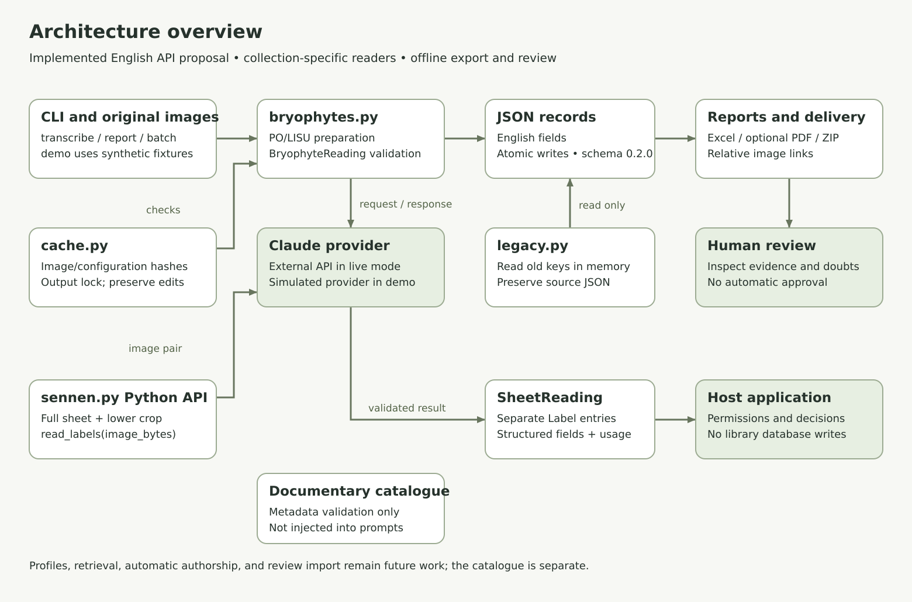
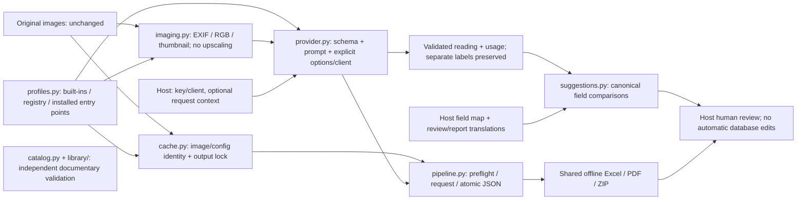

# Architecture overview

This describes the shared architecture published in 0.1.0a3 and extended by the 0.1.0a4 candidate. [Open the SVG](diagrams/architecture.svg) or edit the [Mermaid source](diagrams/architecture.mmd).

Profiles select the scientific prompt, schema, image views, and report columns. Both built-ins share image preparation, Claude requests, cache/persistence, and offline delivery. Sennen retains the full sheet and lower crop without upscaling. Registered and installed entry-point profiles use the same contract from Python and CLI. Folder APIs receive paths and ordinary keyword parameters; CLI adapters delegate to them.

The host owns authentication, optional request concurrency/user limits, field mappings, review-language rendering, and database decisions. An injected client remains caller-owned. Catalogue validation stays independent and does not identify writers or inject examples into prompts.

Cache checks precede requests. Strict conflicts stop; explicit historical acceptance records hashes separately while preserving original JSON; incomplete readings are not saved. The CLI exits nonzero for transcription failures. Batch requires complete input coverage before reports/ZIP. Standalone reports require no competing writer. See [integration](INTEGRATION.md), [testing](TESTING.md), and the remaining [roadmap](https://github.com/MattyDroidX/herbarium-labels/blob/main/PLAN.md).

The host can supply report translations as well as review-suggestion messages. Explicit acceptance stores historical provenance separately from new cache identity; it does not establish scientific approval. See [continuing older folders](INTEGRATION.md#continue-an-older-reviewed-folder).

In 0.1.0a4, `prompts.py` appends the optional uncertainty-language instruction for every profile. The provider and cache use that same effective prompt; an omitted language retains the preceding identity. `messages.py` loads bundled report/review templates independently, so presentation language does not change model requests or cached literal evidence.
