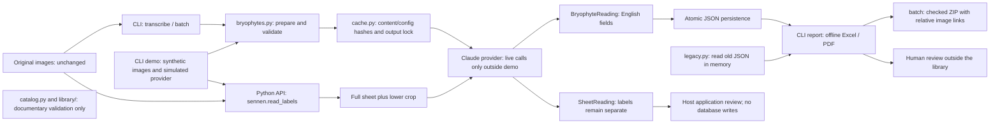

# Architecture overview

This diagram describes the implemented English API proposal (`0.1.0a2`), not the future profile-retrieval roadmap. [Open the standalone SVG](diagrams/architecture.svg) or edit the [Mermaid source](diagrams/architecture.mmd).

| Component | Responsibility and boundary |
| --- | --- |
| `bryophytes.py` | English CLI and PO/LISU reading/report/batch orchestration; scientific fields remain distinct |
| `cache.py` | Content/configuration identity, per-task results, exclusive output lock; no shared worker counters |
| `legacy.py` | Read old field names/statuses in memory; never rewrite source JSON or literal evidence |
| `sennen.py` | Independent Python reader sends the full sheet and lower crop; returns separate labels and usage |
| `catalog.py` / `library/` | Documentary validation of people, samples, rights metadata, sources, attributions; not injected into prompts |
| `demo.py` | Synthetic delivery through the real export code with a simulated provider and artifact verification |
| Host/reviewer | Image permissions, human approval, and any database edits; the library does not supply authentication or review import |

The only live network operation in the transcription paths is the provider request. Reports, JSON loading, catalogue validation, and the synthetic demo work offline once dependencies are installed. Build/dependency-audit tooling may access package/advisory services separately.

The two collection-specific readers intentionally retain distinct scientific models. English interfaces do not imply generic segmentation, universal label understanding, handwriting recognition, or a new canonical v2 pipeline. Those remain in [PLAN.md](../PLAN.md).
