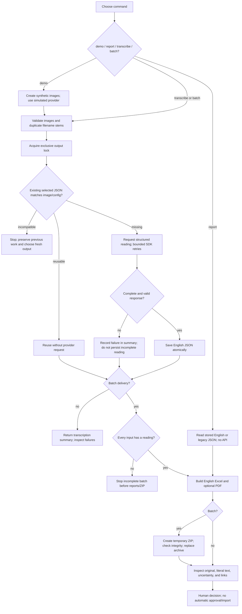

# Workflow diagram

[Open the standalone SVG](diagrams/workflow.svg) or edit the [Mermaid source](diagrams/workflow.mmd). This is the implemented delivery workflow, including failure stops; it does not imply an automated review application.

- **`transcribe`:** validate selected inputs/cache, request missing readings, validate/persist complete results, and return usage/failure totals. Inspect the printed failures: this command currently does not guarantee a nonzero exit status for every per-image provider failure.
- **`report`:** read existing English/legacy JSON, validate image identity when recorded, and generate English reports without a provider call. Standalone reports do not acquire the transcription lock; avoid concurrent writers.
- **`batch`:** keep the output lock throughout transcription and delivery. Require readings for all inputs before reports/ZIP. Preserve an earlier archive if the new ZIP integrity check fails.
- **`demo`:** create a fresh synthetic input directory and mock provider, exercise batch/resume plus the Sennen Python route, and verify the generated files without network or paid usage.
- **Sennen Python route:** return `SheetReading` and usage for the full sheet plus crop. Its semaphore bounds concurrent calls. The host must explicitly invoke any per-user rate helper and perform human approval; these are not automatically provided by the CLI.

Existing JSON is not replaced just because a new model/schema/prompt is requested. Incompatible cache stops the run and asks for a new output directory. Failed/incomplete responses are not promoted to valid readings. A lost paid response before persistence may still require a repeated request.

The final human step is inspection of originals, literal text, field interpretation, uncertainty, and links. An Excel checkbox does not itself register an immutable review event or approve handwriting attribution. See [TESTING.md](TESTING.md) for reproducible checks and [MIGRATION.md](MIGRATION.md) for interface changes.
